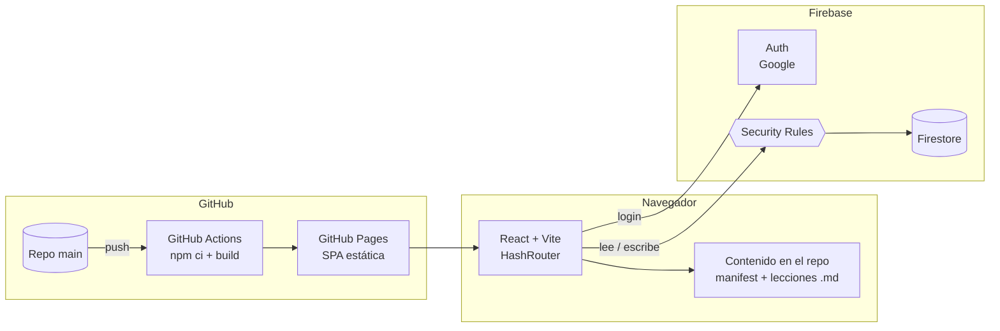

# Arquitectura

## Vista general



- **GitHub Pages** sirve archivos estáticos. No hay backend propio.
- **Firebase Auth** con Google: sin contraseñas (WCAG 3.3.8).
- **Firestore** guarda perfiles, progreso, quizzes y resultados. Las **Security Rules** son la única capa de seguridad real; los guards de React son solo UX.
- El **contenido de estudio** vive en el repo (versionado con git, no gasta lecturas de Firestore). Los **quizzes** viven en Firestore porque el admin los activa en vivo.

## Roles

| | Estudiante | Admin |
|---|---|---|
| Lecciones | En orden, con desbloqueo | Todo desbloqueado |
| Quizzes | Solo los activos | Todos + activar/desactivar |
| Resultados | Solo los suyos | De todo el equipo |
| Progreso de otros | No | Sí |

Los admins se definen por correo en `src/config.ts` y en `isAdmin()` de `firestore.rules` (ambos deben coincidir).

## Progresión guiada

```
Módulo → Lecciones (3–6 min) → Pasos ("Continuar") → Pregunta de control
                                                       │ respondida
                                                       ▼
                                        se desbloquea la siguiente lección
Última lección del módulo → Repaso del módulo (sin nota) → se desbloquea el siguiente módulo
```

- El desbloqueo se calcula en el cliente: `content/manifest.ts` (orden) + `users/{uid}.completedLessons`.
- Bloqueado ≠ oculto: lo futuro se ve con candado y el motivo.
- Lo completado queda libre para repasar.
- Cada lección tiene **3 preguntas de control distintas**. Si falla, ve la respuesta correcta y pasa a otra pregunta; si falla las 3, **se reinicia el módulo completo**. Los fallos se guardan en `users/{uid}.failedChecks`, así que recargar no los borra. Las lecciones completadas quedan en modo práctica.

### Módulos (24 lecciones)

| Módulo | Secciones del reglamento |
|---|---|
| 1. Fundamentos y Espíritu del Juego | Introducción, 1–6 |
| 2. Flujo del juego | 7, 8, 9, 10, 20 |
| 3. Posesión, límites y anotación | 11–14 |
| 4. Llamadas, faltas y violaciones | 15–19 |

Las Definiciones forman el glosario transversal.

## Formato del contenido

Cada módulo es un archivo TypeScript (`src/content/moduloN.ts`) registrado en `src/content/index.ts`. Así el contenido tiene tipos y el build falla si algo está mal formado.

```ts
{
  id: 'm1.l4',
  intro: 'Una frase que dice de qué trata la lección.',
  steps: [                                   // se revelan uno a uno con "Continuar"
    { title: 'Las dos líneas que confunden', blocks: [
      { type: 'p', text: 'Texto con **negrita** y [[linea-de-gol|términos del glosario]].' },
      { type: 'rule', ref: '2.4', text: 'Lo que dice el reglamento.' },
      { type: 'example', text: 'Una jugada concreta.' },
      { type: 'key', text: 'La idea clave.' },
      { type: 'list', items: ['…'], ordered: false },
    ]},
  ],
  checkpoints: [q1, q2, q3],                 // { prompt, options, correct, explanation, ruleRef }
}
```

- `[[slug]]` o `[[slug|texto]]` enlaza al glosario; al tocarlo se abre la definición como hoja fija abajo de la pantalla.
- El repaso de cada módulo (`REPASO_N`) tiene 5–8 preguntas con `lessonId`, para sugerir qué lección repasar si falla.
- El repaso se guarda como `"m{n}.repaso"` en `completedLessons` y es lo que desbloquea el siguiente módulo.

## Modelo de datos (Firestore)

```
users/{uid}
  name, email, photoURL, createdAt, lastSeenAt
  completedLessons: string[]        // ["m1.l1", ...] fuente de verdad del desbloqueo
  completedReviews: number[]        // [1, 2]  (fase 2)
  lastLesson: string | null
  failedChecks: { "m1_l4": 2 }       // fallos por lección; se borra al completar o reiniciar

schedule/{moduleId}                 // anuncio visible para todos
  moduleId, opensOn: "2026-11-05", note

quizzes/{moduleId}                  // 1 quiz por módulo, invisible si active=false
  moduleId, title, active, timeLimitMin, activatedAt
  questions: [{ prompt, options[], correct, lessonId, ruleRef, explanation }]

results/{uid}_{moduleId}            // 1 intento por estudiante por quiz
  uid, name, moduleId, score, total, timedOut, submittedAt
  answers: [{ prompt, selected, correctAnswer, correct, explanation, ruleRef, lessonId }]
  byLesson: { "m2.l4": [aciertos, total], ... }
```

## Rutas

```
/#/login
/#/                              inicio: cancha con los 4 módulos + "continúa donde quedaste"
/#/modulo/:m                     lista de lecciones con estado
/#/modulo/:m/leccion/:id         lección guiada
/#/glosario
/#/quiz/:m                       presentar quiz
/#/quiz/:m/resultado             puntaje con gráfico
/#/admin                         resumen del equipo
/#/admin/estudiante/:uid         detalle por estudiante
/#/admin/quiz/:m                 abrir, calendario, estadísticas, CSV
```

## Quizzes

- **Banco de preguntas** en `src/content/quizBank.ts` (10 por módulo, distintas a las de las lecciones). Solo lo carga el panel admin (import diferido). Al **abrir** un quiz, sus preguntas se copian a `quizzes/{m}`; los estudiantes las leen de ahí.
- Mientras `active == false`, las rules no dejan leer `quizzes/{m}`: las preguntas no llegan al navegador del estudiante. El cliente consulta con `where('active', '==', true)`.
- **Calendario** en `schedule/{m}`: fecha y nota, visibles para todos. El quiz no se abre solo: el admin lo abre ese día.
- **Presentar:** una pregunta a la vez, sin feedback hasta el final, opciones barajadas, navegación libre, tiempo límite opcional (al agotarse se envía solo). El borrador vive en `localStorage` para sobrevivir a una recarga; un candado (`useRef`) impide el doble envío.
- **Calificación** en el cliente (equipo de confianza). El resultado guarda cada respuesta con su texto, para poder revisarla aunque el quiz se cierre.
- **Un intento:** el ID `{uid}_{m}` y la regla `create` sin `update` lo garantizan. El admin puede borrar el intento.
- **Pantalla de resultado:** anillo con el puntaje, estado Aprobado / Por reforzar (umbral 60 %), barras de aciertos por lección y enlaces a repasar.
- **Admin:** KPIs, estado de los 4 quizzes, matriz estudiantes × quizzes, y por quiz: abrir/cerrar, anuncio, promedio, histograma, % de aciertos por pregunta, tabla por estudiante, reinicio de intento y CSV. Detalle por estudiante con progreso y resultados.

### Pruebas locales sin Firebase

`.mock/` (fuera de git) tiene versiones en memoria de `firebase/app`, `firebase/auth` y `firebase/firestore`, con datos de ejemplo y las restricciones clave de las rules. `npx vite --config vite.mock.config.ts` levanta la app completa; `?as=s3` (estudiante) o `?as=adm` (admin) elige el usuario.

## Sistema de diseño

**Concepto:** el recorrido es la cancha. Los 4 módulos son tramos de la zona central, de tu zona de defensa a la zona de anotación; terminar el módulo 4 es anotar.

**Identidad del equipo:** colores y recursos del afiche oficial de Uniagustiniana (azul marino, amarillo, blanco), franjas de brocha amarillas, sombras desplazadas amarillas y tipografía itálica pesada. Agusti, la mascota, es el favicon y el logo.

| Token | Hex | Uso |
|---|---|---|
| `--navy` | `#031A40` | Header, footer, hero, cancha |
| `--royal` | `#0A3A8C` | Azul UA: links, completados |
| `--yellow` | `#FFE100` | Único acento: actual, CTA, brocha (siempre con texto navy) |
| `--bg` | `#F3F5FA` | Fondo de lectura |
| `--ink` | `#0B1A3A` | Texto (≈16:1) |
| `--line` | `#D3DAE8` | Bordes |

- **Tipografía:** Archivo (una familia, ejes de ancho e itálica). Títulos itálicos condensados 800, cuerpo 17 px / 1.6, máximo 68 caracteres por línea, cifras tabulares.
- **Motion:** una sola animación orquestada (el disco entra a la zona de anotación). Todo respeta `prefers-reduced-motion`.
- **Copy:** sentence case, verbos que dicen lo que pasa ("Completar lección", "Siguiente lección").

### Accesibilidad (WCAG 2.2 AA)

| Criterio | Implementación |
|---|---|
| 1.4.1 / 1.4.3 | Contraste ≥ 4.5:1; estados con ícono + texto, nunca solo color |
| 2.4.1 | Enlace "Saltar al contenido" |
| 2.4.7 / 2.4.11 | Foco de 3 px visible; `scroll-padding-top` para que el header sticky no lo tape |
| 2.5.7 | Sin drag & drop |
| 2.5.8 | Controles de mínimo 44 px |
| 3.2.6 | Glosario siempre en el mismo lugar del header |
| 3.3.8 | Login con Google, sin contraseña |
| 4.1.2 | `role="progressbar"` con valores; `aria-disabled` en bloqueados |
| 4.1.3 | Feedback y errores en `aria-live` |

### Responsive

Sistema fluido, sin saltos bruscos entre tamaños:

| Técnica | Dónde |
|---|---|
| **Tipografía fluida** con `clamp(mín, rem + vw, máx)`, de 320 px a 1440 px | `--fs-*` en `index.css` (cuerpo 16→18 px, h1 32→56 px) |
| **Espaciado fluido** con `clamp()` | `--space-1` … `--space-7` |
| **Contenedores en %** con tope: `width: min(100% - 2 × gutter, 72rem)` | header, main, footer |
| **Gutter proporcional** al viewport: `clamp(1rem, 4vw, 2.5rem)` | márgenes laterales |
| **Container queries**: cada componente se adapta a su espacio, no a la pantalla | cancha (`≥ 46em` → horizontal), hero (`≥ 40em` → 2 columnas), admin (`≤ 40em` → tarjetas) |
| **Proporciones reales de la cancha en %**: zonas de anotación 18 % + zona central 64 % (4 × 25 %), `aspect-ratio: 100 / 37` | `FieldMap.css` |
| **Unidades `cqi`** para que números y títulos de la cancha escalen con su ancho | `FieldMap.css` |
| **Breakpoints en `em`**, no en px: respetan el zoom y el tamaño de fuente del usuario | header (`25em`, `35em`, `21.25em`) |
| `100dvh`, `env(safe-area-inset-*)` | login, header y footer en celulares con notch |

Verificado sin scroll horizontal (`scrollWidth − innerWidth = 0`) en 320, 390, 768, 1024 y 1440 px, y con zoom al 200 %. Cumple WCAG 1.4.4 (texto al 200 %) y 1.4.10 (reflow a 320 px).
