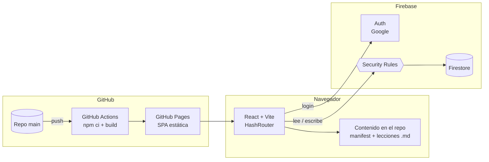

# Arquitectura

## Vista general



- **GitHub Pages** sirve archivos estáticos. No hay backend propio.
- **Firebase Auth** con Google: sin contraseñas (WCAG 3.3.8).
- **Firestore** guarda perfiles, progreso, quizzes y resultados. Las **Security Rules** son la única capa de seguridad real; los guards de React son solo UX.
- El **contenido de estudio** vive en el repo (versionado con git, no gasta lecturas de Firestore). Los **quizzes** viven en Firestore porque el admin los activa en vivo.

## Roles

| | Estudiante | Admin |
|---|---|---|
| Lecciones | En orden, con desbloqueo | Todo desbloqueado |
| Quizzes | Solo los activos | Todos + activar/desactivar |
| Resultados | Solo los suyos | De todo el equipo |
| Progreso de otros | No | Sí |

Los admins se definen por correo en `src/config.ts` y en `isAdmin()` de `firestore.rules` (ambos deben coincidir).

## Progresión guiada

```
Módulo → Lecciones (3–6 min) → Pasos ("Continuar") → Pregunta de control
                                                       │ respondida
                                                       ▼
                                        se desbloquea la siguiente lección
Última lección del módulo → Repaso del módulo (sin nota) → se desbloquea el siguiente módulo
```

- El desbloqueo se calcula en el cliente: `content/manifest.ts` (orden) + `users/{uid}.completedLessons`.
- Bloqueado ≠ oculto: lo futuro se ve con candado y el motivo.
- Lo completado queda libre para repasar.
- La pregunta de control da feedback inmediato con la regla; no bloquea por fallar, solo por no responder.

### Módulos (24 lecciones)

| Módulo | Secciones del reglamento |
|---|---|
| 1. Fundamentos y Espíritu del Juego | Introducción, 1–6 |
| 2. Flujo del juego | 7, 8, 9, 10, 20 |
| 3. Posesión, límites y anotación | 11–14 |
| 4. Llamadas, faltas y violaciones | 15–19 |

Las Definiciones forman el glosario transversal.

## Modelo de datos (Firestore)

```
users/{uid}
  name, email, photoURL, createdAt, lastSeenAt
  completedLessons: string[]        // ["m1.l1", ...] fuente de verdad del desbloqueo
  completedReviews: number[]        // [1, 2]  (fase 2)
  lastLesson: string | null

schedule/{moduleId}                 // anuncio visible para todos (fase 3)
  moduleId, opensOn: "2026-11-05", note

quizzes/{moduleId}                  // 1 quiz por módulo, invisible si active=false (fase 3)
  moduleId, title, active, timeLimitMin?
  questions: [{ prompt, options[], correct, lessonId, ruleRef, explanation }]

results/{uid}_{moduleId}            // 1 intento por estudiante por quiz (fase 3)
  uid, name, moduleId, score, total, submittedAt
  answers: [{ q, selected, correct }]
  byLesson: { "m2.l4": [aciertos, total], ... }
```

## Rutas

```
/#/login
/#/                              inicio: cancha con los 4 módulos + "continúa donde quedaste"
/#/modulo/:m                     lista de lecciones con estado
/#/modulo/:m/leccion/:id         lección guiada
/#/glosario
/#/quiz/:m                       presentar quiz (fase 3)
/#/quiz/:m/resultado             puntaje con gráfico (fase 3)
/#/admin                         resumen del equipo
/#/admin/estudiante/:uid         detalle por estudiante (fase 4)
/#/admin/quiz/:m                 activar, calendario, estadísticas, CSV (fase 4)
```

## Quizzes

- Cada módulo tiene su quiz. El admin publica la fecha en `schedule/{m}` para que el equipo se prepare y activa `quizzes/{m}.active` ese día.
- Mientras `active == false`, las rules no dejan leer el documento: las preguntas no llegan al navegador del estudiante.
- La calificación es en el cliente (equipo de confianza).
- **Pantalla de resultado:** anillo con el puntaje + barras de aciertos por lección (`byLesson`) con enlace a repasar los temas con menos de 60 %.
- **Admin:** matriz estudiantes × módulos, % de aciertos por pregunta, quién falta, reinicio de intento y CSV.

## Sistema de diseño

**Concepto:** el recorrido es la cancha. Los 4 módulos son tramos de la zona central, de tu zona de defensa a la zona de anotación; terminar el módulo 4 es anotar.

| Token | Hex | Uso |
|---|---|---|
| `--tiza` | `#F7F8F4` | Fondo |
| `--tinta` | `#18231D` | Texto (≈15:1) |
| `--pasto` | `#1F5B3A` | Mapa-cancha y progreso |
| `--cono` | `#FF6B1A` | Único acento (con texto tinta encima) |
| `--cono-oscuro` | `#B8400E` | Acento como texto o link (≥ 4.5:1) |
| `--linea` | `#D9DED6` | Bordes |

- **Tipografía:** Archivo (una familia, eje de ancho). Títulos condensados 750, cuerpo 17 px / 1.6, máximo 68 caracteres por línea, cifras tabulares.
- **Motion:** una sola animación orquestada (el disco entra a la zona de anotación). Todo respeta `prefers-reduced-motion`.
- **Copy:** sentence case, verbos que dicen lo que pasa ("Completar lección", "Siguiente lección").

### Accesibilidad (WCAG 2.2 AA)

| Criterio | Implementación |
|---|---|
| 1.4.1 / 1.4.3 | Contraste ≥ 4.5:1; estados con ícono + texto, nunca solo color |
| 2.4.1 | Enlace "Saltar al contenido" |
| 2.4.7 / 2.4.11 | Foco de 3 px visible; `scroll-padding-top` para que el header sticky no lo tape |
| 2.5.7 | Sin drag & drop |
| 2.5.8 | Controles de mínimo 44 px |
| 3.2.6 | Glosario siempre en el mismo lugar del header |
| 3.3.8 | Login con Google, sin contraseña |
| 4.1.2 | `role="progressbar"` con valores; `aria-disabled` en bloqueados |
| 4.1.3 | Feedback y errores en `aria-live` |
